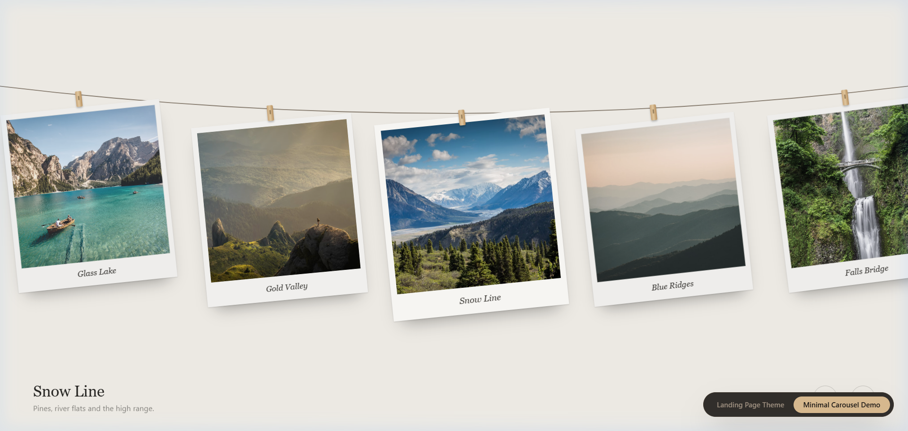
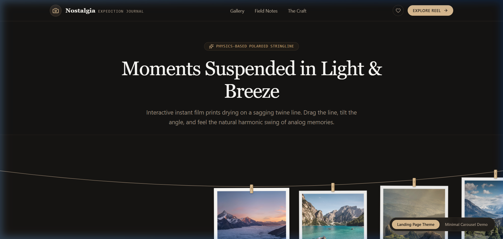
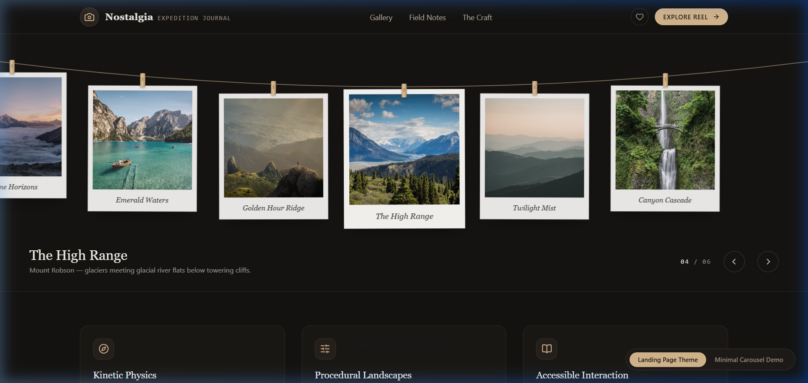

# Hanging Polaroid Line Carousel & Interactive Landing Page Theme

A physics-based, interactive React component featuring vintage instant Polaroid prints suspended on a sagging twine line. Photos gently sway on wooden clothes pegs in harmonic breeze, dynamically respond to pointer drags, mouse pulls, and keyboard arrow controls, with real-time momentum damping and velocity overshoot.

---

## 📸 Visual Showcase & Previews

### Figure 1: Minimal Carousel Demo View
*Clean, distraction-free gallery line with cream background, wooden pegs, sag curvature, and pagination controls.*



---

### Figure 2: Travel Expedition Landing Page Theme (Hero Section)
*Full-featured editorial showcase with sticky navigation, camera badge, high-resolution alpine photography, and responsive typography.*



---

### Figure 3: Kinetic Physics & Interactive Field Notes (Scrolled View)
*Under-carousel feature breakdown detailing spring physics, procedural canvas generation, and live active-slide story synchronization.*



---

## 🛠 Tech Stack

| Technology | Purpose |
| :--- | :--- |
| **React 19** | Core reactive component architecture |
| **TypeScript** | Strict typing for slides, palettes, physics state, and prop interfaces |
| **Tailwind CSS v4** | Modern utility-first styling with `@tailwindcss/vite` |
| **Vite 8** | Ultra-fast local development server with instantaneous HMR |
| **Lucide React** | Modern, lightweight icons (`Camera`, `Compass`, `MapPin`, `Sparkles`, `Heart`, etc.) |
| **HTML5 Canvas 2D** | Procedural multi-layer ridge landscape generator when photography assets are absent |

---

## 📦 Required Libraries & Dependencies

Run the following command inside your project directory to install all required dependencies:

```bash
# Core styling & UI icons
npm install lucide-react clsx tailwind-merge

# Tailwind CSS with Vite plugin
npm install -D tailwindcss @tailwindcss/vite
```

### Why Each Library is Needed:
- **`lucide-react`**: Provides crisp SVG icons for exploration badges, heart toggles, share buttons, and compass indicators.
- **`clsx` & `tailwind-merge`**: Standard shadcn utility helpers for conditional and collision-free Tailwind class merging.
- **`@tailwindcss/vite`**: The official Vite plugin for Tailwind CSS v4, enabling seamless `@import "tailwindcss";` without legacy PostCSS boilerplate.

---

## 📂 Exact File Paths & Architecture

To adhere to **shadcn UI** project conventions, place each file in its dedicated path:

```
minimal-carousel-demo/
├── docs/
│   └── images/
│       ├── minimal-carousel-demo.png     # Minimal demo screenshot
│       ├── landing-page-hero.png         # Landing page hero preview
│       └── landing-page-field-notes.png  # Scrolled feature notes preview
├── src/
│   ├── components/
│   │   └── ui/
│   │       ├── polaroid-line-carousel.tsx # Core Polaroid component
│   │       └── demo.tsx                   # Standalone minimalist demo
│   ├── examples/
│   │   └── landing-pages/
│   │       └── travel-memories-landing-page.tsx # Full landing page theme
│   ├── lib/
│   │   └── utils.ts                      # shadcn 'cn' utility helper
│   ├── App.tsx                           # Root app with live view toggle
│   ├── main.tsx                          # Application entry point
│   └── index.css                         # Global CSS & Tailwind import
├── index.html                            # HTML root
├── package.json                          # Dependencies & scripts
├── tsconfig.app.json                     # TypeScript compiler & '@/*' path alias
├── tsconfig.json                         # TS project references
└── vite.config.ts                        # Vite plugins & '@' alias resolver
```

### Path Placement Rationale:
1. **`src/components/ui/polaroid-line-carousel.tsx`**:
   - `components/ui/` is the standard shadcn path for atomic, reusable UI primitives. Keeping it here ensures seamless integration with future shadcn components added via `npx shadcn@latest add <component>`.
2. **`src/components/ui/demo.tsx`**:
   - A reference integration with 6 curated high-resolution landscape photography prints.
3. **`src/examples/landing-pages/travel-memories-landing-page.tsx`**:
   - Separates page-level composition, copy, badges, and layout from primitive UI building blocks.

---

## ⚙️ How to Run the Project (Step-by-Step)

### Step 1: Clone the Repository
```bash
git clone https://github.com/Tanisharma122/websites.git
cd websites
```

### Step 2: Navigate to the Demo Directory
```bash
cd "Web Designs Examples/minimal-carousel-demo"
```

### Step 3: Install Dependencies
```bash
npm install
```

### Step 4: Start the Development Server
```bash
npm run dev
```

### Step 5: Open in Browser
Open your browser and navigate to:
```
http://localhost:5173/
```

- Click the floating switcher at the bottom-right corner to toggle between **Landing Page Theme** and **Minimal Carousel Demo**.
- Drag the string line with mouse/touch or use the `←` and `→` keyboard arrows to slide and swing the photos!

---

## 🧩 Component Props API (`PolaroidLineCarouselProps`)

| Prop | Type | Default | Description |
| :--- | :--- | :--- | :--- |
| `slides` | `Slide[]` | `DEFAULT_SLIDES` | Array of slide objects (`image`, `title`, `caption`, `alt`, `palette`, `seed`). |
| `height` | `number \| string` | `"100svh"` | Any valid CSS height for the carousel container. |
| `cardWidth` | `number` | `300` | Width of an individual polaroid print in pixels (auto-shrinks on mobile). |
| `sag` | `number` | `46` | Parabolic curvature sag of the twine line at center (px). |
| `swing` | `number` | `1` | Amplitude of harmonic pendulum swing (`0` disables swinging). |
| `autoplay` | `number` | `4500` | Autoplay interval in milliseconds (`0` disables autoplay). |
| `string` | `string` | `"#8a7f72"` | Color of the twine rope and clothes pegs. |
| `background` | `string` | `var(--color-background, #efece6)` | Canvas background color or CSS variable. |
| `ink` | `string` | `var(--color-foreground, #161513)` | Foreground typography color. |
| `onChange` | `(index: number) => void` | `undefined` | Callback fired when the centered, active photo changes. |

---

## 🎨 Zero-Asset Procedural Fallback
If an item in `slides` omits the `image` property, the component automatically paints a high-resolution, layered mountain landscape at runtime via the HTML5 `<canvas>` API with atmospheric mist, sunrise halo, and film grain in one of 4 color palettes:
- `dawn` (warm peach & rose mist)
- `alpine` (crisp ice blue & snow peaks)
- `dusk` (deep violet twilight & amber horizon)
- `mist` (sage green & quiet fog)

---

## ♿ Accessibility & Motion Sensitivity
- **Keyboard Navigation**: Pressing `ArrowLeft` or `ArrowRight` smoothly glides to adjacent prints.
- **ARIA Live Regions**: Screen readers automatically announce current photo numbers, titles, and captions.
- **Reduced Motion Support**: Respects `prefers-reduced-motion: reduce` by dampening swings and disabling title slide-up animations.
